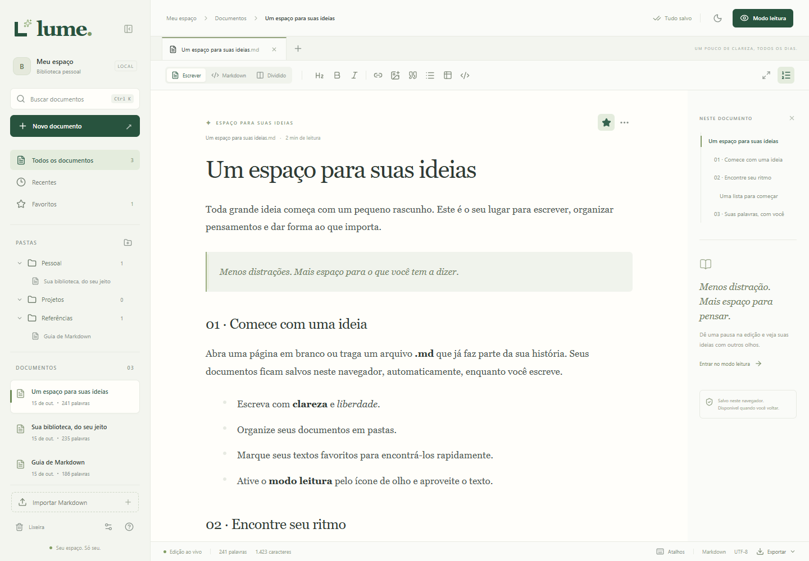

# Lume

Um espaço tranquilo para escrever, ler e organizar ideias em Markdown. Aplicação Web estática, com identidade própria, pronta para GitHub Pages.



## O que está incluído

- Editor visual ao vivo, código Markdown e visão dividida.
- **Modo leitura pelo ícone de olho**, modo foco, temas claro/escuro/sistema e ajuste de fonte.
- Importação de `.md`, `.markdown` e `.txt`, múltiplos arquivos, arrastar e soltar e importação de pastas.
- Biblioteca persistente com pastas e subpastas, renomeação, movimentação, duplicação, favoritos, recentes e lixeira recuperável.
- Busca por nome/conteúdo, localizar e substituir, abas de documentos e sumário clicável.
- Títulos, listas, tarefas, tabelas, citações, links, imagens, código com destaque, fórmulas KaTeX e diagramas Mermaid na leitura.
- Metadados YAML preservados; edição desses metadados no modo Markdown.
- Exportação Markdown, HTML, impressão/PDF e backup JSON de toda a biblioteca.
- Salvamento automático em IndexedDB, cópia de emergência, recuperação do snapshot anterior e proteção contra edição concorrente em duas abas.
- Uso offline após o primeiro carregamento e cache completos da versão publicada.

Não há cadastro, servidor de documentos, analytics ou sincronização remota. Publicar o site distribui a aplicação; **os documentos de cada visitante continuam no navegador dele**.

## Executar localmente

Requer Node.js **22.12 ou superior** e npm.

```sh
npm ci
npm run dev
```

Abra o endereço exibido no terminal. Para conferir a versão compilada:

```sh
npm run build
npm run preview
```

Para simular um repositório no GitHub Pages, inclusive o caminho `/lume/`:

```sh
npm run preview:pages
```

Abra `http://127.0.0.1:4175/lume/`. Esse comando usa o conteúdo de `dist/`, que precisa ter sido gerado antes.

## Publicar no GitHub Pages

1. Crie um repositório público no GitHub, por exemplo `lume`.
2. Envie os arquivos do projeto para a branch `main`. Inclua `package-lock.json` e `.github/workflows/deploy.yml`. Não envie `node_modules`, `dist`, `investigation` ou `test-results`; já estão no `.gitignore`.
3. No repositório, abra **Settings → Pages → Build and deployment → Source** e selecione **GitHub Actions**.
4. Em **Actions**, execute **Publicar Lume no GitHub Pages**, ou envie um novo commit para `main`.
5. Quando o workflow concluir, o site estará em `https://SEU-USUARIO.github.io/SEU-REPOSITORIO/`.

O workflow instala as versões travadas, executa os testes unitários, compila e publica **somente `dist/`**. O `base: './'` do Vite permite usar qualquer nome de repositório sem editar caminhos. Se a branch principal tiver outro nome, ajuste o gatilho do workflow.

O projeto está preparado para publicação; nenhum repositório remoto ou site público é criado automaticamente.

## Dados, backups e limites

- A biblioteca pertence à **origem, navegador, perfil e dispositivo** usados. Mudar de domínio, navegador ou dispositivo cria outro armazenamento. Caminhos no mesmo domínio compartilham a biblioteca.
- Fechar a aba ou reiniciar o navegador mantém os documentos. Limpar dados do site, janela anônima, políticas de descarte ou perda do dispositivo podem removê-los. Use **Preferências → Baixar backup** regularmente.
- A importação cria uma cópia local. Editar no Lume não sobrescreve o arquivo original no computador.
- Importar um backup **adiciona** documentos e pastas com novos identificadores; não substitui a biblioteca existente. Preferências atuais são mantidas nesse caso. A recuperação após erro de abertura preserva o snapshot original antes de substituí-lo.
- Uma aba por vez pode editar. Outras abas abrem para leitura e exportação; feche a aba de edição e recarregue para assumir a escrita.
- Importação: até 9 MB por arquivo. Limites internos: 10 milhões de caracteres por documento, 25 milhões na biblioteca, 10 mil documentos e 2 mil pastas. A quota efetiva depende do navegador.
- Imagens escolhidas pelo seletor são incorporadas ao Markdown como data URLs e consomem a quota. Referências relativas de imagens em arquivos importados não copiam automaticamente os arquivos de imagem; use o seletor para incorporá-las ou URLs públicas.
- Recursos, fontes e bibliotecas são empacotados localmente. Imagens externas e links dependem dos respectivos servidores.
- HTML embutido não é executado. URLs perigosas são bloqueadas, fórmulas usam `trust: false` e Mermaid usa modo restrito com sanitização de SVG.
- A edição visual normaliza a sintaxe Markdown. Use o modo Markdown para controlar exatamente espaços, marcadores e extensões incomuns. Metadados YAML iniciais são preservados sem conversão.
- O HTML exportado é independente, usa MathML para fórmulas e preserva diagramas como código Mermaid. Para exportar diagramas renderizados, use impressão/PDF após abrir o modo leitura.
- PDF usa a impressão do navegador. Não há conversor de DOCX/EPUB, colaboração simultânea ou acesso automático às pastas reais do sistema operacional.

## Atalhos

| Ação | Atalho |
| --- | --- |
| Buscar documentos | `Ctrl K` |
| Localizar e substituir | `Ctrl F` |
| Exportar Markdown | `Ctrl S` |
| Alternar editor e Markdown | `Ctrl /` |
| Modo leitura | `Ctrl Shift L` |
| Novo documento | `Ctrl Alt N` |
| Negrito / itálico | `Ctrl B` / `Ctrl I` |
| Fechar diálogo / sair da leitura ou foco | `Esc` |

No macOS, use `⌘` no lugar de `Ctrl`. No editor visual, digite `/` em uma linha vazia para inserir blocos.

## Verificação

```sh
npm test
npm run build
npm run test:e2e
```

Os testes de navegador usam Edge instalado no Windows e o servidor local na porta 4174. Inicie `npm run dev -- --port 4174` antes. Em CI, o Playwright usa Chromium; instale com `npx playwright install --with-deps chromium` e defina `CI=true`.

O teste de produção/offline fica em `tests/offline.spec.ts`. Com `npm run preview:pages` ativo, execute no PowerShell:

```powershell
$env:LUME_PRODUCTION_TEST = '1'
npm run test:e2e -- tests/offline.spec.ts
Remove-Item Env:LUME_PRODUCTION_TEST
```

Os testes cobrem persistência após fechar/reabrir, importação/exportação, backup inválido, pastas e prevenção de ciclos, favoritos, lixeira, múltiplas abas, edição rica, isolamento de documentos, segurança do Markdown, busca, celular e operação offline sob subdiretório.

## Estrutura

- `src/App.tsx`: biblioteca, comandos e interface.
- `src/components/MarkdownEditor.tsx`: editor visual Milkdown/ProseMirror.
- `src/components/MarkdownView.tsx`: leitura segura, matemática e diagramas.
- `src/lib/storage.ts`: IndexedDB, backups e recuperação.
- `src/lib/library.ts`: modelo, validações e organização.
- `src/styles.css`: identidade visual e layout responsivo.
- `.github/workflows/deploy.yml`: publicação automática.

Construído com React, TypeScript, Vite, Milkdown, React Markdown, KaTeX, Mermaid e Lucide. Consulte [THIRD_PARTY_NOTICES.md](THIRD_PARTY_NOTICES.md) para as bibliotecas principais.
